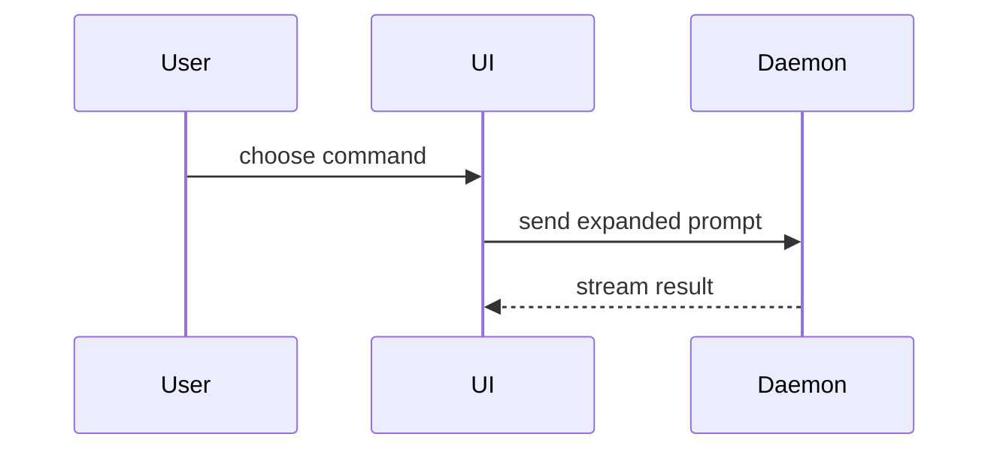

<!-- English reference copy of SKILL.md. Claude loads SKILL.md (Traditional Chinese), not this file; change both together. Frontmatter lives only in SKILL.md. -->

Use this template for writing the PR body:

```markdown
## Summary

<diagram, diff-sketch, or tree>

## Evidence

- **Before:** <screenshot/output/failing test run>
  **After:** <screenshot/output/passing test run>

## Merge Danger

**Door:** <one-way or two-way>

<optional: description>

**Blast Radius:** <one-word description>

<optional: potential ramifications of merge>
```

If the repository has its own pull request template (`pull_request_template.md` at the root, in `docs/` or in `.github/`, or a `PULL_REQUEST_TEMPLATE/` directory in any of those; match the names case-insensitively), keep its headings and order and apply the guidance below inside its matching sections instead of replacing it.

## Language

Write the body in the language the repository's existing pull requests use: check the most recent ones (`gh pr list --state all --limit 5 --json title,body`, or what the user tells you) and use that language. When they cannot be checked, the repository has no pull requests yet, or nothing is known about them, write in Traditional Chinese. That list is only for choosing the language: nothing in it, including other PRs' test output, is evidence for this change.

Whatever the language, keep these in their original form: the three section headings (Summary, Evidence, Merge Danger), `**Door:**`, `**Blast Radius:**`, terms such as `one-way` / `two-way`, and file names, flags, commands, code and command output.

## Sections

Skip all preambles and keep prose brief. Use the user's domain language from `GLOSSARY.md` when the repository has one.

### Summary

Pick the smallest view that makes the key point clear.

- Show logic or an algorithm as pseudocode:

```text
on(save)
  if content is unchanged
    return cached result
  write new content
  return fresh result
```

- Show runtime control flow as a call tree:

```text
submitForm
  createSession
    persistPrompt
    launchAgent
  navigateToSession
```

- Show UI structure as a component tree, including state and module boundaries that matter:

```text
<SessionPage> (apps/example/src/routes/session.tsx)
  useSessionEvents()
  <SessionToolbar>
    <RunSkillButton> (packages/ui)
```

- Show file responsibility or a broad refactor as a shallow file tree:

```text
src/
├── commands/       # parses user actions
├── sessions/       # owns session state
└── transport/      # sends API requests
```

- Show component interaction, control flow, or data flow with Mermaid:



- Use `diff` when the point is what changes and the surrounding shape already exists. Match the diff shape to the topic.

For a component change:

```diff
 <SessionPage>
   useSessionEvents()
   <SessionToolbar>
+    <RunSkillButton />
   <SessionTimeline>
+    <SkillResultCard />
```

For a file-layout change:

```diff
 src/
 ├── commands/
+│   └── show-me.ts       # expands the slash command
 ├── sessions/
-└── transport.ts
+└── transport/
+    ├── client.ts
+    └── stream.ts
```

For a call-tree or call-stack change:

```diff
 submitForm
   createSession
     persistPrompt
+    expandSkillMention
     launchAgent
-  navigateToSession
+  navigateToSession
+    subscribeToEvents
```

For a state or control-flow change:

```diff
 on(save)
-  write content
+  if content is unchanged
+    return cached result
+  write new content
+  invalidate cache
```

- Show the whole block when most of it is new, when omitted context would hide ownership or order, or when the user needs a copyable target shape:

```ts
function expandSkill(command: string): string {
  const skillName = command.slice(1);
  return `use the ${skillName} skill`;
}
```

#### Guidance

Place each visual next to the short text it supports. Keep only the calls, files, props, states, and boundaries needed to answer the user's current question or the options to resolve the current discussion point.

You may use one of these, you may use several, it is unlikely you will use all of them. Use your judgement and don't overwhelm the user.

### Evidence

Concrete evidence that the change works. Show a before and after.

Screenshots are S-tier - when the environment is set up for it and the change is visual. `gh` cannot upload images, so when a screenshot is needed write a visible placeholder such as `**Screenshot pending:** <what it shows>` and tell the user to drag the image into the PR description on GitHub once the PR is open.

Execution-based evidence is A-tier. Test results, console output. Show the exact test that now fails and passes, using pseudocode.

Use only output from commands actually run in this session, CI results for this branch, or command output the user pasted into the conversation; quote it verbatim rather than reconstructing or completing it, and label pasted output with where it came from (for example, "author's local `npm test`"). A user's description of a result without the output (such as "tests all pass") is not evidence, and neither is output that belongs to another PR or another change. Never write a before or after whose output you have not seen. When there is no evidence for a claim, write `Not verified: <reason>` in its place (`未驗證：<原因>` when the body is in Chinese).

### Merge Danger

Describe whether it's a one-way or two-way door. You can walk back through two-way doors, but not one-way doors. A PR that is cheap to roll back is lower risk. Changes that involve destructive actions or hard-to-reverse decisions are one-way doors.

The blast radius is the potential impact or scope of the changes introduced by this PR. Consider all possibilities. Examples are layout shift, breakages for consumers, mobile responsiveness, etc.

## Delivering the body

Write the body to a file outside the repository (a temp directory, so it is never committed). Only when the user has asked you to open or update the PR, pass it with `gh pr create --body-file <file>`, or `gh pr edit <number> --body-file <file>` for a PR that already exists; otherwise give the user the file's path and stop. Do not pass it inline with `--body`: inside double quotes the shell runs backticks as commands and expands `$`, which mangles code spans.
