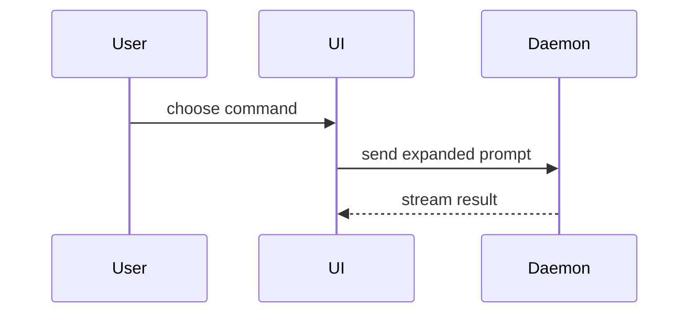

<!-- 本檔是 Claude 載入的版本。英文對照版在同目錄的 SKILL.en.md，模型不會讀它；改規則時兩份要一起改。 -->

PR body 用這個模板：

```markdown
## Summary

<圖、diff 草圖或樹狀圖>

## Evidence

- **Before:** <截圖／輸出／失敗的測試執行>
  **After:** <截圖／輸出／通過的測試執行>

## Merge Danger

**Door:** <one-way 或 two-way>

<選填：說明>

**Blast Radius:** <一個詞的描述>

<選填：merge 之後可能的影響>
```

如果 repo 有自己的 PR template（root、`docs/` 或 `.github/` 底下的 `pull_request_template.md`，或這三處任一個 `PULL_REQUEST_TEMPLATE/` 目錄；檔名比對不分大小寫），保留它的段落標題與順序，把下面的寫法套進對應的段落，不要用這份模板取代它。

## 語言

body 的語言跟著這個 repo 既有的 PR：先看最近幾個 PR 用什麼語言寫（`gh pr list --state all --limit 5 --json title,body`，或使用者提供的資訊），就用那個語言。查不到、repo 還沒有任何 PR，或手邊沒有任何資訊時，用繁體中文。這份 PR 清單只用來判斷語言，裡面的內容（包括其他 PR 的測試輸出）不能當成這次變更的證據。

不論用哪個語言，下列一律保留原文：三個段落標題（Summary、Evidence、Merge Danger）、`**Door:**`、`**Blast Radius:**`、`one-way`／`two-way` 等欄位與術語，以及檔名、旗標、指令、程式碼與命令輸出。

## 各段寫法

不要前言，文字要短。repo 有 `GLOSSARY.md` 時，用裡面的領域用語。

### Summary

挑最小、足以把重點說清楚的呈現方式。

- 邏輯或演算法用 pseudocode：

```text
on(save)
  if content is unchanged
    return cached result
  write new content
  return fresh result
```

- 執行時的控制流程用 call tree：

```text
submitForm
  createSession
    persistPrompt
    launchAgent
  navigateToSession
```

- UI 結構用 component tree，標出重要的 state 與模組邊界：

```text
<SessionPage> (apps/example/src/routes/session.tsx)
  useSessionEvents()
  <SessionToolbar>
    <RunSkillButton> (packages/ui)
```

- 檔案職責或大範圍重構用淺層的 file tree：

```text
src/
├── commands/       # 解析使用者動作
├── sessions/       # 管理 session 狀態
└── transport/      # 送出 API 請求
```

- 元件互動、控制流程或資料流用 Mermaid：



- 重點是「哪裡變了」、而周圍結構本來就存在時，用 `diff`。diff 的形狀要配合主題。

元件變更：

```diff
 <SessionPage>
   useSessionEvents()
   <SessionToolbar>
+    <RunSkillButton />
   <SessionTimeline>
+    <SkillResultCard />
```

檔案配置變更：

```diff
 src/
 ├── commands/
+│   └── show-me.ts       # 展開 slash command
 ├── sessions/
-└── transport.ts
+└── transport/
+    ├── client.ts
+    └── stream.ts
```

call tree 或 call stack 變更：

```diff
 submitForm
   createSession
     persistPrompt
+    expandSkillMention
     launchAgent
-  navigateToSession
+  navigateToSession
+    subscribeToEvents
```

狀態或控制流程變更：

```diff
 on(save)
-  write content
+  if content is unchanged
+    return cached result
+  write new content
+  invalidate cache
```

- 大部分是新內容、省略上下文會看不出歸屬或順序，或使用者需要一份可以直接複製的目標形狀時，貼出整段：

```ts
function expandSkill(command: string): string {
  const skillName = command.slice(1);
  return `use the ${skillName} skill`;
}
```

#### 原則

每張圖放在它支撐的那段短文字旁邊。只留下回答使用者眼前問題、或解決目前討論點所需的呼叫、檔案、props、state 與邊界。

可以用一種，也可以用好幾種，但不太會全部都用到。自己判斷，別讓讀者被淹沒。

### Evidence

證明這個變更有效的具體證據，要有 before 和 after。

截圖是最高等級，前提是環境允許、而且變更是視覺上的。`gh` 沒辦法上傳圖片，所以需要截圖時，寫一行看得見的佔位，例如 `**Screenshot pending:** <要拍什麼>`，並請使用者在 PR 開好後，到 GitHub 上把圖片拖進 PR 描述。

執行結果是次一級的證據：測試結果、console 輸出。用 pseudocode 寫出「現在會失敗、修好後會通過」的那個測試。

證據只能來自這次 session 實際跑過的命令輸出、這個分支的 CI 結果，或使用者在對話中貼上的命令輸出，一律逐字引用，不要自己重寫或補齊；使用者貼上的要註明來源（例如「作者本機 `npm test`」）。使用者只用文字描述結果（例如「測試都過了」）而沒有貼出輸出，不算證據；屬於其他 PR 或其他變更的輸出也不算。沒看到輸出的 before 或 after 一律不寫。某項主張沒有證據時，在那個位置寫 `Not verified: <原因>`；body 用中文時寫 `未驗證：<原因>`。

### Merge Danger

說明這是 one-way 還是 two-way door。two-way door 可以走回頭，one-way door 不行。容易 rollback 的 PR 風險較低；牽涉破壞性動作或難以撤回的決定，就是 one-way door。

blast radius 是這個 PR 帶來的變更可能影響的範圍。把各種可能都想過，例如版面位移、使用者端的相容性破壞、行動裝置的版面等。

## 交付 body

把 body 寫進 repo 外的檔案（放在暫存目錄，才不會被 commit）。只有在使用者要求開或更新 PR 時，才用 `gh pr create --body-file <file>` 交給 GitHub；PR 已存在就用 `gh pr edit <number> --body-file <file>`。使用者沒有這樣要求時，把檔案路徑告訴使用者就停。不要用 `--body` 直接帶入內容：在雙引號裡，shell 會把反引號當成命令執行，也會展開 `$`，code span 會被弄壞。
